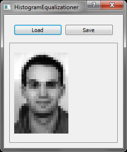

# HistogramEqualizationer

Performs a histogram equalization on an image.

HistogramEqualizationer is one of [Richèl Bilderbeek's
tools](https://richelbilderbeek.github.io/tools/).

## Links

- [Source code](https://github.com/richelbilderbeek/HistogramEqualizationer)
- [Richèl Bilderbeek's tools](https://richelbilderbeek.github.io/tools/)
